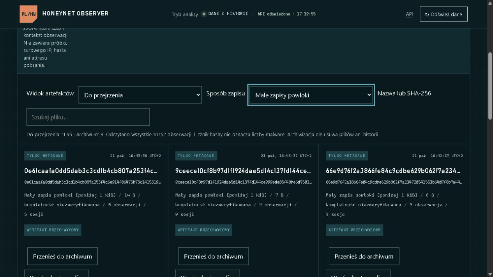

# Studium przypadku: równoległe sesje rozpoznania i transferu

21 października 2026 · analiza telemetrii własnego honeypota SSH

## Problem

Jeden hash powtarzał się w tysiącach obserwacji. Celem analizy było ustalenie,
czy reprezentuje pełny plik, jak przebiegają transfery oraz czy oddzielne sesje
rozpoznania i przesyłania danych tworzą wspólny schemat zachowania.

## Materiał i metoda

- Przejrzano 11 380 sesji i 165 534 zdarzenia z zachowanej historii VPS.
- Spis sesji zebrano 21 października między 14:05:01 a 14:06:44 UTC.
  Każdą oś ograniczono do `last_seen` odpowiadającego jej podsumowania;
  wyłączono 12 późniejszych zdarzeń. Zbiór nie jest atomowym snapshotem.
- Sprawdzono wszystkie 2 201 sesji zawierających wskazany hash, nie tylko
  przykłady pokazywane na pierwszej stronie panelu.
- Sesje porównywano po pseudonimizowanym źródle, nakładaniu się przedziałów
  czasu, przebiegu komend i odstępie między zakończeniami. Każda sesja mogła
  należeć najwyżej do jednej pary.
- Niezależne przeliczenie potwierdziło liczniki i dopasowanie par; sprawdzono
  także wyniki przy innych progach czasowych.

Raport udostępnia agregaty. Nie zawiera surowych logów, identyfikatorów sesji,
adresów IP, danych logowania, materiału kluczy ani przechwyconych plików.

## Wyniki

| Obserwacja | Wynik |
| --- | ---: |
| Sesje zawierające dominujący hash | 2 201 |
| Przechwycenia tego hasha | 6 571 |
| Pseudonimizowane źródła | 11 |
| Rozmiar zachowanego fragmentu | 16 744 448 B |
| Sesje z trzema komendami SCP do kolejnych katalogów | 2 196 |
| Sesje z trzema przechwyceniami tego samego hasha | 2 174 |
| Pary z osobną sesją rozpoznania, zakończone do 25 ms od siebie | 2 132 |
| Pary mieszczące się w 5 ms | 1 725 |
| Mediana odstępu zakończeń dopasowanych par | 1,2735 ms |

Sesje transferowe wskazywały kolejno `/var/tmp`, `/tmp` i `/dev/shm`.
Nie zawierały innych komend ani zarejestrowanej komendy uruchomienia pliku.

Każda z 2 132 dopasowanych sesji rozpoznania miała 14 komend. Pierwsze 13 było
identycznych w całej tej grupie, także między źródłami. Różnice pełnych
sekwencji dotyczyły końcowego `echo`. Ostatnia komenda sesji rozpoznania
poprzedzała pierwsze przechwycenie fragmentu; oba połączenia kończyły się
niemal równocześnie.

Wniosek: dane mocno wspierają hipotezę powtarzalnego automatycznego scenariusza
z dwiema równoległymi rolami: rozpoznaniem/przygotowaniem oraz transferem.
Podobieństwo nie dowodzi tożsamości operatora, a przechwycenie nie potwierdza
wykonania przesłanej zawartości.

## Wyjątki i kontrola interpretacji

27 sesji odbiegało od schematu trzech przechwyceń głównego hasha: 22 miały
dodatkowe przechwycenie o innym hashu, cztery nie miały zdarzenia zamknięcia,
a jedna miała trzy komendy i tylko dwa zapisane przechwycenia. Inny hash
fragmentu nie jest sam w sobie dowodem innej rodziny malware.

Próg 25 ms jest kryterium eksploracyjnym. Po przesunięciu przedziałów sesji
rozpoznania o ±1, ±10 i ±60 sekund liczba par spadała do 2–12. To kontrola
pomocnicza, nie dowód związku przyczynowego ani test atrybucji.

Identyczna komenda czyszczenia miała wcześniej zapis błędu, a później odpowiedź
emulowaną przez sensor. Zmiany reakcji sensora nie utożsamiano ze zmianą
taktyki klienta ani skutecznym usunięciem procesów.

## Kontrolowane testy kompletności SCP/SFTP

W lokalnym laboratorium wykonano 14 transferów własnych, nieszkodliwych danych:
po siedem przez SCP i SFTP, o rozmiarach poniżej, równych i powyżej 16 MiB.
Rzeczywiście zapisane bajty i ich SHA-256 porównano ze znanym wzorcem.

Osiem transferów zachowało pełny wzorzec, sześć było skróconych. Przy badanym
limicie SCP uwzględniało ramkę protokołu i pomijało blok przekraczający limit;
w próbie granicznej zapisało 16 MiB minus 64 B. SFTP zachowało pełne 16 MiB,
a większy transfer został przerwany. Nie zwiększano limitu przechwytywania.

Test potwierdził mechanizm w sprawdzonej lokalnej konfiguracji. Nie ustalił
automatycznie przyczyny każdego historycznego fragmentu z VPS. Identyczny hash
zachowanych bajtów nie dowodzi identyczności całych przesyłanych plików.

## Usprawnienia wersji operatora

W prywatnym wdrożeniu na VPS wprowadzono filtr sposobu zapisu pliku, jawny
zakres odczytanych obserwacji oraz wspólne okno danych dla kolejki, manifestu
i przeglądu. Usunięto ciche ograniczenie kolejki do 10 000 obserwacji.
Skonfigurowany limit wynosi 50 000; ewentualne ucięcie jest sygnalizowane.

Poprawiono również walidację nazw parametrów HTTP i odczyt starszych metadanych.
Uzupełniono trzy karty dochodzeń, zachowując status analizy częściowej.

*Zrzut wersji operatora z 21 października. Liczniki panelu pochodzą z późniejszego
odczytu niż zamrożony zbiór tego studium; nie należy ich łączyć. Mały zapis
powłoki opisuje pochodzenie i rozmiar, nie nieszkodliwość pliku.*

## Zakres i dalsza praca

Ta publikacja zawiera dokumentację i zrzut ekranu. Kod opisanych rozszerzeń
nie jest jeszcze częścią publicznej wersji repozytorium. Testy wersji operatora
nie są deklaracją przejścia testów publicznego klonu.

Następny test lokalny powinien odtworzyć dwie równoległe sesje własnego klienta
z transferem znanych danych i rejestracją zamknięć obu połączeń. Eksperyment
A/B persony NAS jest przygotowany, ale nie został uruchomiony na VPS.

Analiza i przegląd były wspomagane narzędziami AI. Interpretacja rozdziela
obserwacje, hipotezy i ograniczenia. Dane dotyczą zachowanej historii własnego
sensora; nie mierzą całego Internetu ani ataków ukierunkowanych na Polskę.

[Stan projektu](project-status-2026-10.md) · [Prywatność](privacy.md) ·
[Obsługa próbek](sample-handling.md)
